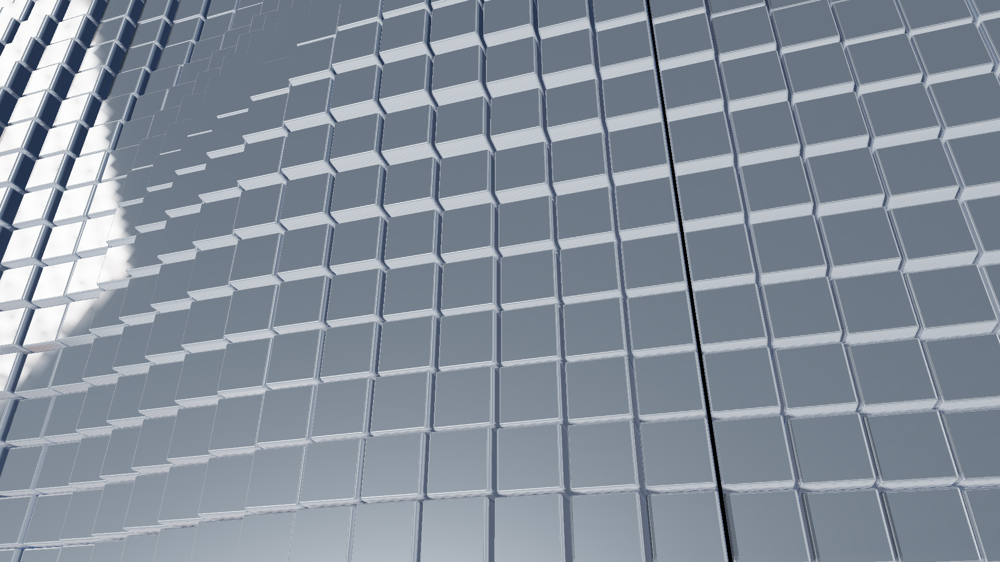
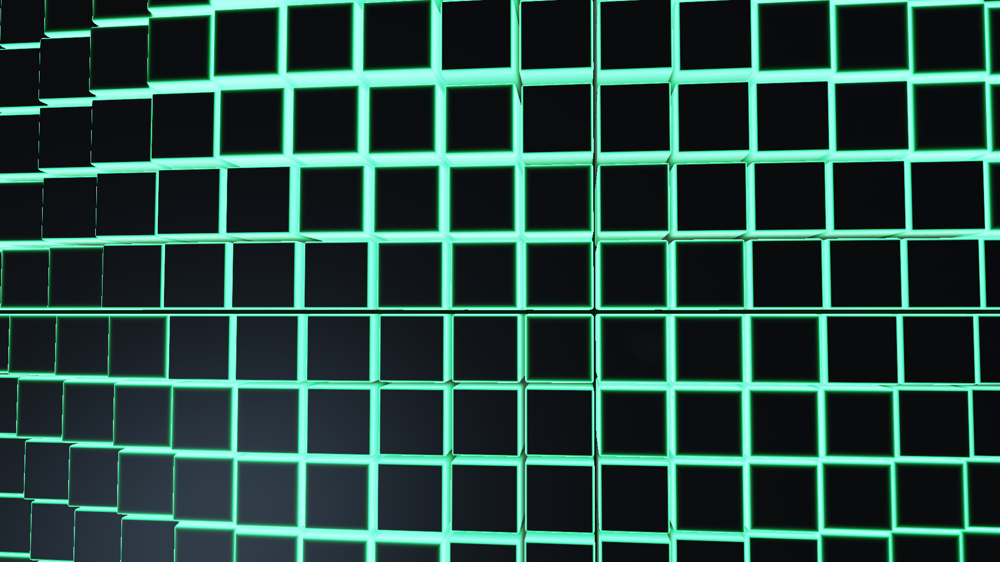
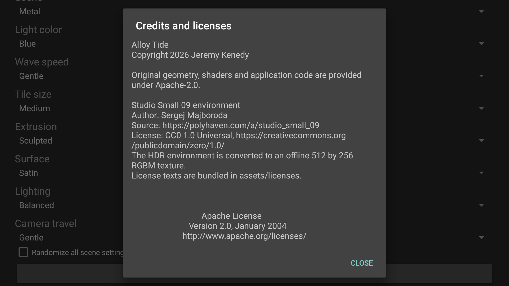

<p align="center">
  <a href="https://github.com/jeremykenedy/alloy-tide#gh-light-mode-only"><picture><source media="(max-width: 600px) and (prefers-reduced-motion: reduce)" srcset="art/banner-mobile-still-light.43e49fa23c49.svg"><source media="(prefers-reduced-motion: reduce)" srcset="art/banner-still-light.ea3f5ab41309.svg"><source media="(max-width: 600px)" srcset="art/banner-mobile-light.75611288e2cf.svg"></picture></a>
  <a href="https://github.com/jeremykenedy/alloy-tide#gh-dark-mode-only"><picture><source media="(max-width: 600px) and (prefers-reduced-motion: reduce)" srcset="art/banner-mobile-still-dark.468077afa509.svg"><source media="(prefers-reduced-motion: reduce)" srcset="art/banner-still-dark.ce1d0a23095a.svg"><source media="(max-width: 600px)" srcset="art/banner-mobile-dark.2e5576f57a4a.svg"></picture></a>
</p>

<p align="center">Animated beveled metal and neon tile fields for TV.</p>

<p align="center">
  <a href="https://github.com/jeremykenedy/alloy-tide/actions/workflows/ci.yml"></a>
  <a href="LICENSE"></a>
</p>
<p align="center">
  <a href="https://github.com/jeremykenedy"></a>
  <a href="https://github.com/jeremykenedy/alloy-tide/stargazers"></a>
  <a href="https://github.com/sponsors/jeremykenedy"></a>
</p>

Show your support by starring this repository on GitHub.

This source candidate has native Google TV emulator evidence. Its visual quality, physical Fire TV performance and first signed public release are still being evaluated.

## Table of contents

- [Requirements](#requirements)
- [Installation](#installation)
- [Fire TV Toolkit](#fire-tv-toolkit)
- [Quick start](#quick-start)
- [Features](#features)
- [Configuration](#configuration)
- [Privacy](#privacy)
- [Testing](#testing)
- [Documentation](#documentation)
- [Screenshots](#screenshots)
- [License](#license)

## Requirements

Android API 23 or later and OpenGL ES 2.0. Google TV API 34 host-GPU emulator playback has been checked at 1920x1080. Physical Fire TV, other TV models and 4K remain untested; a volunteer with each device is needed to report startup, output resolution, remote behavior and sustained performance. Building uses JDK 21, Android SDK 36 and build-tools 36.0.0. The computer installer uses Python 3 and ADB.

## Installation

A public signed release is pending. To build and install the source candidate:

```sh
bash build.sh
python3 install.py --serial YOUR_TV_IP:5555 --apk build/alloy-tide.apk
```

Repeat the installer command to update without deleting preferences. Select another screensaver before uninstalling with `python3 install.py --serial YOUR_TV_IP:5555 --uninstall`. The installer does not change screensaver selection or TV timers. Uninstalling removes this app's preferences.

## Fire TV Toolkit

[Fire TV Toolkit](https://github.com/jeremykenedy/fire-tv-toolkit) provides guided ADB setup, screensaver installation, launcher choices, TV timers and supported settings protection:

```sh
git clone https://github.com/jeremykenedy/fire-tv-toolkit.git
cd fire-tv-toolkit
node setup.js
```

The `alloy-tide` registry entry is pending its verified signed release and host integration. Once those are published, the exact commands will be:

```sh
firetv-screensavers --install=alloy-tide --yes
firetv-set-screensaver --set=alloy-tide --yes
firetv-screensavers --install=alloy-tide --yes
firetv-screensavers --uninstall=alloy-tide --yes --force
```

Fire TV UI discovers an installed protected DreamService and opens its app-owned settings. Its download catalog needs the verified release pin and preview before it can install this app. Neither host integration is claimed complete here.

## Quick start

Open Alloy Tide on the TV, choose **Preview animation**, and press Back to return. Choose the scene, metal, light and wave controls with the D-pad. Select Alloy Tide in the TV screensaver settings after installation.

## Features

- Continuous waves of real beveled geometry, with changing depth and camera movement.
- Silver, graphite, champagne and copper surfaces with a bundled studio lighting map.
- Metal and neon scenes with configurable colored edge lighting.
- Nine validated choices with per-setting Random and a randomize-all switch.
- Offline settings, credits and full licenses; no words or watermarks in the animated scene.

## Configuration

| Setting | Choices | Default |
| --- | --- | --- |
| Metal finish | Silver, graphite, champagne, copper | Silver |
| Scene | Metal, neon | Metal |
| Light color | Blue, green, violet, amber | Blue |
| Wave speed | Slow, gentle, flowing | Gentle |
| Tile size | Large, medium, small | Medium |
| Extrusion | Subtle, sculpted, dramatic | Sculpted |
| Surface | Polished, satin, brushed | Satin |
| Lighting | Dim, balanced, bright | Balanced |
| Camera travel | Gentle, wide | Gentle |

Each choice also accepts Random. Randomize all selects independent values when a scene starts. Choices persist locally and apply at the next scene start. The stable provider publishes its schema at `content://com.jeremykenedy.alloytide.settings/schema` and stored values at `content://com.jeremykenedy.alloytide.settings/settings`.

## Privacy

The app requests no Android permissions. Its meshes, shaders and licensed lighting texture are bundled. It contains no accounts, ads, analytics, reporting client or runtime content downloads. The separate computer installer contacts GitHub only when invoked to download a release.

## Testing

```sh
bash test.sh
bash build.sh --unsigned
python3 scripts/check-artifact.py build/alloy-tide-unsigned.apk
python3 scripts/check-docs.py
```

Host tests enforce 100% line and branch coverage for scoped mesh/options logic and the standalone installer. Android framework, lifecycle, EGL and GPU behavior require native validation and are outside that host coverage boundary. See the [verification record](docs/VERIFICATION.md).

## Documentation

- [Building and assets](docs/BUILDING.md)
- [Device and visual verification](docs/VERIFICATION.md)
- [Host integration contract](docs/INTEGRATION.md)
- [Implementation checkpoint](docs/checkpoint.md)

## Screenshots

Actual API 34 native output at 1920x1080, without retouching. These show the current candidate; final visual acceptance and physical pacing remain open.

<table>
  <tr>
    <td></td>
    <td></td>
    <td></td>
  </tr>
</table>

## License

This project is open-sourced software licensed under the [Apache License 2.0](LICENSE). The studio lighting map is CC0; its attribution and full license are included in [NOTICE](NOTICE) and the APK.
